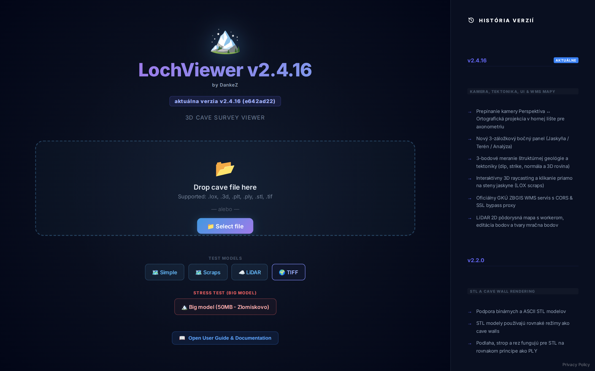
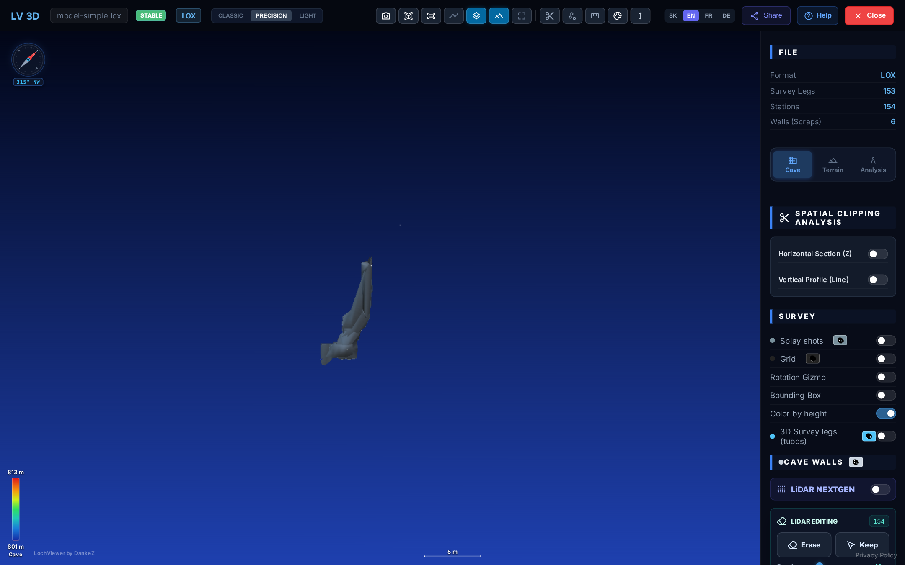
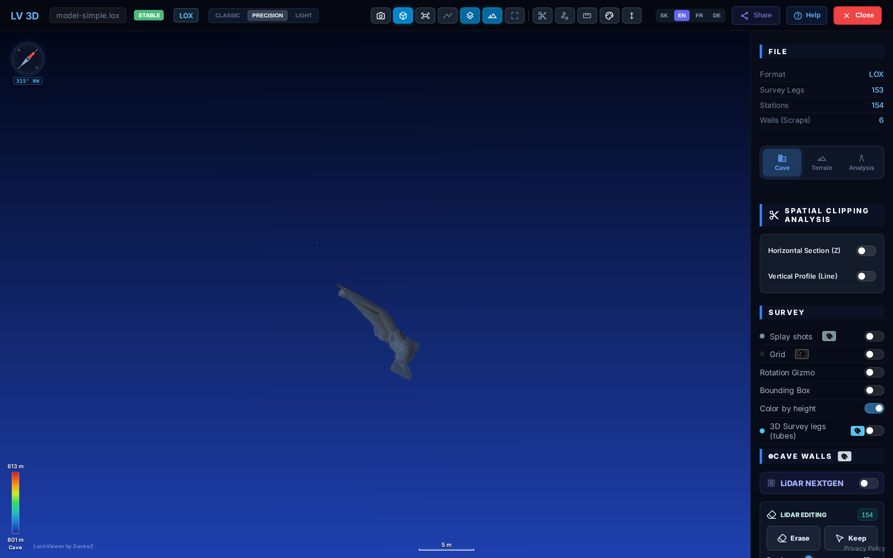
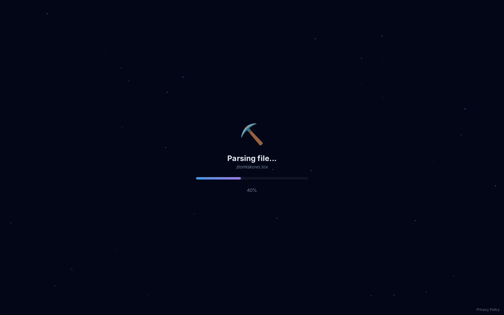
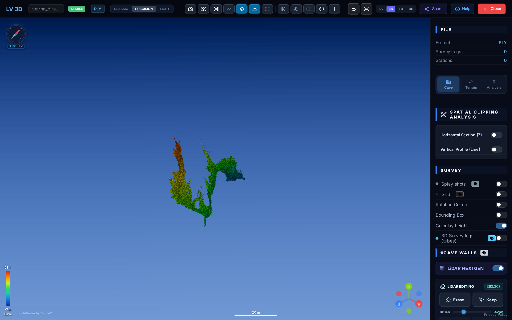
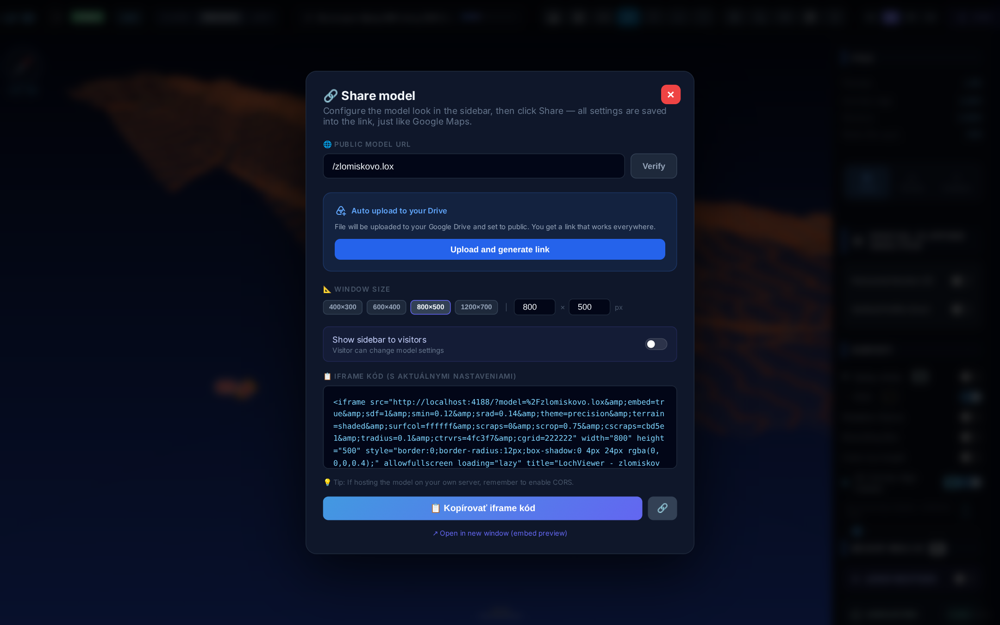
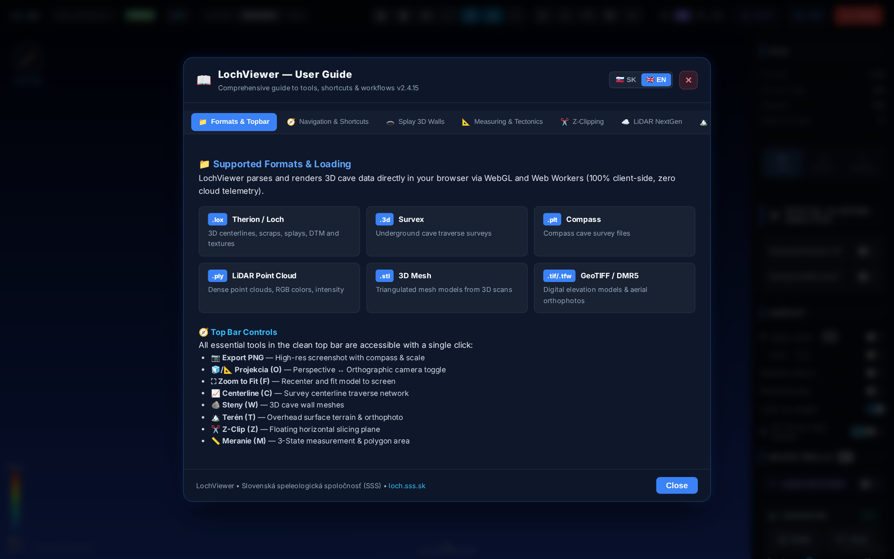

# 📖 LochViewer - Kompletná používateľská príručka (v2.4.34)

*Webová 3D platforma pre vizualizáciu, speleologické meranie a analýzu jaskynných systémov a LiDAR dát.*  
*Dizajnový systém: Stitch CAD Precision Glassmorphism & Fieldwork High-Contrast (vrátane jemného pieskového gradientu vo svetlom režime).*  
*Oficiálny portál: [loch.sss.sk](https://loch.sss.sk)*

---

## 📑 Obsah
1. [Podporované formáty a načítanie dát](#1-podporované-formáty-a-načítanie-dát)
2. [Používateľské rozhranie (Horná lišta, nástroje a farebné motívy)](#2-používateľské-rozhranie-horná-lišta-nástroje-a-farebné-motívy)
3. [Navigácia v priestore a technické pohľady](#3-navigácia-v-priestore-a-technické-pohľady)
4. [Modelovanie 3D stien z laserových lúčov (Splay SDF)](#4-modelovanie-3d-stien-z-laserových-lúčov-splay-sdf)
5. [Nástroje merania vzdialeností, plôch a štruktúrnej geológie (Tektonika)](#5-nástroje-merania-vzdialeností-plôch-a-štruktúrnej-geológie-tektonika)
6. [Priestorové rezy a profilové analýzy (Z-Clipping)](#6-priestorové-rezy-a-profilové-analýzy-z-clipping)
7. [Práca s LiDAR mračnami bodov (Engine v2 NextGen)](#7-práca-s-lidar-mračnami-bodov-engine-v2-nextgen)
8. [Povrchový terén, oficiálny GKÚ ZBGIS WMS a 3D kalibrácia](#8-povrchový-terén-oficiálny-gkú-zbgis-wms-a-3d-kalibrácia)
9. [Zdieľanie modelov a vkladanie cez Iframe (Embed)](#9-zdieľanie-modelov-a-vkladanie-cez-iframe-embed)
10. [Interaktívny sprievodca v aplikácii (Help Modal)](#10-interaktívny-sprievodca-v-aplikácii-help-modal)
11. [Prehľad klávesových skratiek a gest](#11-prehľad-klávesových-skratiek-a-gest)
---

## 1. Podporované formáty a načítanie dát

LochViewer spracováva dáta priamo vo vašom internetovom prehliadači prostredníctvom WebGL a paralelných Web Workerov. Vaše dáta sa neposielajú na žiadny cudzí server – spracovanie je 100% lokálne a bezpečné.



### Podporované formáty súborov:
* **`.lox` (Therion / Loch)**: Základný štandard speleologických 3D modelov. Obsahuje polygónový ťah (centerline), stanice, laserové lúče (splays), ručne kreslené polygóny stien (scraps), povrchový terén (DTM) a mapové textúry.
* **`.3d` (Survex)**: Štandardný formát softvéru Survex. Podporuje podzemné aj povrchové polygónové ťahy a stanice.
* **`.plt` (Compass)**: Formát speleologického programu Compass obsahujúci polygonálne traverzy a shoty.
* **`.ply` (LiDAR Point Cloud)**: Binárne aj textové mračná bodov s podporou miliónov bodov, RGB farieb, intenzity odrazu a klasifikácií.
* **`.stl` (3D Mesh)**: Trojrozmerné triangulované siete jaskynných priestorov vytvorené laserovým skenovaním alebo fotogrametriou.
* **`.tif / .tiff` (GeoTIFF) + `.tfw`**: Digitálne modely reliéfu (DMR) a ortofotomapy v súradnicovom systéme S-JTSK Křovák alebo UTM.

### Spôsoby načítania modelu:
1. **Presunutie myšou (Drag & Drop)**: Potiahnite ľubovoľný podporovaný súbor zo svojho počítača a pustite ho priamo do okna prehliadača.
2. **Tlačidlo Otvoriť súbor**: Na úvodnej obrazovke kliknite na tlačidlo **„Vybrať 3D súbor“**.
3. **URL parameter**: Model je možné načítať priamo z webovej adresy pomocou parametra `?model=https://...` (napr. z Google Drive alebo vlastného servera).

---

## 2. Používateľské rozhranie (Horná lišta a nástroje)

Po načítaní modelu bočný panel združuje podrobné nastavenia do piatich kategórií. Horná lišta obsahuje rýchle ikony s názvom pri podržaní kurzora; tyrkysová označuje zapnutý režim. Na malých obrazovkách pás ikon posúvajte vodorovne.

Poradie rýchlych akcií: **Otvoriť model, Znovu načítať pôvodný model, Export PNG, Rotácia, Ortogonál/perspektíva, Pôdorys, Nárys, Fit, Vchody, Pevné stanice, Všetky stanice, Popisy staníc, Polygonálny ťah, Splaye, Steny, Povrch, Pridať obraz na povrch, Meranie, Vertikálny rez (nožnice) a Celá obrazovka**. Reload znovu spracuje uchovaný pôvodný súbor a zahodí úpravy modelu; neobnovuje stránku ani nečíta zmenený súbor z disku. Pevné stanice sú dostupné len pri príslušných metadátach formátu (príznak fixed v LOX), nie podľa GPS či vchodu. Opakované kliknutie na **Pôdorys** prepína pohľad zhora ↔ zdola (sever ostáva hore, pohľad zdola je zrkadlový). Opakované kliknutie na **Nárys** obieha model zo štyroch strán: z juhu → z východu → zo severu → zo západu. Aktuálna strana sa zobrazí v popise tlačidla.

**Popisy staníc** cyklujú **číslo → úplný názov → nadmorská výška → GPS → vypnuté**; bez dostupných GPS sa tento krok preskočí. LOX zachováva úplné mená typu `1@jaskyna`. Steny a Povrch skryjú jednotlivé reprezentácie vrstvy a opätovným zapnutím obnovia ich nastavenie. Obraz na povrch otvorí menu pre miestny obraz, jeho kalibráciu alebo ortofotomapu ZBGIS; podrobné kalibrácie zostávajú vo **Vrstvy & dáta → Povrch**. Dodatočné rýchle ikony sprístupňujú Meranie a spoločné splay lúče/body.

Každá rýchla ikona (okrem súboru a celej obrazovky) zároveň prepne bočný panel na príslušnú kategóriu, rozbalí ho a krátko zvýrazní zodpovedajúce nastavenie – napr. Splaye → *Vrstvy & dáta → Polygón*, Meranie → *Nástroje & analýza*.

**Vertikálny rez (nožnice)**: kliknite na ikonu nožníc v hornej lište alebo zapnite *Nástroje & analýza → Vertikálny profil (línia)* a potom kliknite v modeli na 2 body (stanice, splay body alebo terén). Model sa odreže zvislou rovinou cez túto líniu; posun a otočenie strany sú hneď viditeľné pod prepínačom. Tlačidlo *Vytvoriť rez (línia)* vyberie novú líniu, opätovné kliknutie na nožnice rez vypne.

| Kategória | Ovládanie |
| :--- | :--- |
| **Súbor & projekty** | Otvorenie/zatvorenie modelu, ukážky; **Zdieľanie a dostupné exporty** obsahuje zdieľanie/iframe, PNG, vytvorenú textúru/kalibráciu a WebM záznam vrátane dĺžky nahrávania. |
| **Pohľad & kamera** | Perspektíva/ortogonál, prednastavené pohľady, Fit, výškový systém a automatická rotácia. |
| **Vrstvy & dáta** | Meračská sieť, splay lúče aj koncové body, steny, stanice a LiDAR. **Povrch** výhradne združuje terén, zdroje textúr, TIFF import a kalibráciu jaskyne/povrchu vrátane 3D gizma. |
| **Nástroje & analýza** | Meranie vzdialenosti/plochy, horizontálne/profilové rezy, tektonika, prierez/objem a LiDAR analýzy/mapy. |
| **Nastavenia & pomoc** | Motív, legenda, jazyk, celá obrazovka a pomocník. |

Hlavné prepínače vrstiev sú dostupné bez otvorenia **Podrobností**. Priehľadnosť, farby, SDF a LiDAR parametre sú v príslušnom accordione a zobrazujú sa podľa aktívnej vrstvy alebo dostupných dát. Na počítači panel zbalíte na pás ikon a otvoríte výberom kategórie. Na mobile ho otvorí tlačidlo menu; Tab/Shift+Tab zostávajú v paneli, Escape alebo krížik ho zatvoria a vrátia fokus. Enter/medzerník ovládajú prepínače aj accordiony. Kategórie sú preložené do SK/EN/FR/DE.



Nasledujúce nástroje zostávajú v uvedených kategóriách; najčastejšie akcie majú aj skratku v hornej lište:

| Ikona | Názov nástroja | Popis funkcie |
| :--- | :--- | :--- |
| 📷 | **Exportovať snímku (PNG)** | Vytvorí snímku aktuálneho 3D pohľadu vo vysokom rozlíšení vrátane legendy, mierky a severky. |
| 🧊 / 📐 | **Projekcia kamery (O)** | Prepína medzi **Perspektívou** (realistická 3D hĺbka) a **Ortogonálnym zobrazením** (technická axonometria bez skreslenia vzdialeností). |
| ⛶ | **Prispôsobiť na stred (Fit)** | Automaticky vycentruje a priblíži celý jaskynný systém do zorného poľa kamery. |
| 📈 | **Polygonálny ťah (Centerline)** | Zapína / vypína zobrazenie kostry jaskynného ťahu so zameranými stanicami. |
| 🪨 | **Model stien (Walls)** | Prepína zobrazenie plných 3D stien jaskyne (Therion scraps, Splay SDF model, STL sieť). |
| 🏔️ | **Povrchový terén (Terrain)** | Zobrazuje / skrýva 3D model nadložného povrchu, DMR tieňovanie alebo satelitnú mapu. |
| 🔲 | **Ohraničujúci kváder (Box)** | Zobrazí priestorový bounding box s vyznačením rozmerov $X, Y, Z$ a celkového prevýšenia jaskyne. |
| ✂️ | **Horizontálny rez (Z-Clip)** | Otvorí plávajúci posuvník pre horizontálne zrezávanie modelu podľa nadmorskej výšky. |
| ⚡ | **Laserové lúče a body (Splays)** | Spoločne zapína / vypína pomocné laserové lúče aj ich koncové splay body zamerané zo staníc k stenám jaskyne. |
| 📏 / 📐 | **Merací nástroj (3-Stavový)** | Cyklický prepínač merania: **Vypnuté** ➡️ **Vzdialenosť (2 body)** ➡️ **Plocha/Polygón (3+ body)**. |
| 🎨 | **Farebná schéma** | Prepína medzi speleologickým výškovým spektrom, jednofarebným technickým materiálom a gradientom. |
| 📊 | **Výškový systém (ABS / REL)** | Prepína výškové zobrazenie medzi absolútnou nadmorskou výškou ($m\ \text{n. m.}$) a relatívnou výškou k vchodu ($+120\ \text{m},\ -35\ \text{m}$). |
| ❓ | **Návod a Pomocník** | Otvorí interaktívneho sprievodcu funkciami a klávesovými skratkami priamo v aplikácii. |
| 🔗 | **Zdieľať (Share)** | Vygeneruje trvalý odkaz a HTML kód `<iframe>` pre vloženie modelu na webstránku. |
| ✖ | **Zavrieť model** | Uvoľní pamäť a vráti vás na úvodnú obrazovku. |

### Farebné motívy a vizuálny štýl (Themes):
V **Nastavenia & pomoc → Vzhľad a legenda** alebo cez URL parameter `?theme=` je možné zvoliť jeden z troch kalibrovaných motívov:
* **Precision CAD (`precision`)**: Predvolený profesionálny technický motív s kalibrovaným vertikálnym modrým gradientom (zhora tmavá nočná modrá `#103258` prechádzajúca do svetlejšej technickej modrej `#1d5b9b`), vysoko kontrastnými tyrkysovými (`#00d2ff`) a smaragdovými (`#10b981`) akcentmi podľa špecifikácie Google Stitch CAD. Poskytuje dokonalú priestorovú hĺbku a vysokú čitateľnosť pre speleologické polygóny.
* **Svetlý pieskový motív (`light`)**: Prírodný vysokokontrastný terénny režim s jemným vertikálnym pieskovým gradientom – svetlá slonovinová piesková hore (`#f7f3eb`) prechádzajúca do teplejšej tmavej pieskovej / vápencovej dole (`#d5c4ad`). Prvky CAD rozhrania v tomto režime plynulo ladia s teplou pieskovou paletou, čo znižuje únavu očí pri dennom svetle a zabezpečuje excelentnú čitateľnosť meračských polygónov a textov staníc.
* **Classic Speleo (`classic`)**: Tradičný nočný modrý motív s indigovým gradientom pozadia.
* **Skrytie a znovuotvorenie bočného panela:** Na počítači panel zbalíte na pás ikon a otvoríte výberom kategórie. Na mobile slúži tlačidlo menu pri pravom okraji plátna.

---

## 3. Navigácia v priestore a technické pohľady



### Základné ovládanie myšou:
* **Ľavé tlačidlo myši + potiahnutie**: Otáčanie modelu okolo stredu záujmu (Orbit).
* **Pravé tlačidlo myši (alebo Shift + Ľavé tlačidlo)**: Posun pohľadu (Pan).
* **Koliesko myši**: Plynulé približovanie a vzďaľovanie (Zoom).
* **Dvojklik na stanicu alebo stenu**: Hladký prelet kamery (Street View flight) k vybranému miestu.

### Smerová ružica (Severka & Živý azimut):
V ľavom hornom rohu 3D scény sa nachádza speleologická smerová ružica. Červená šípka neustále ukazuje smer ku geografickému Severu. Pod ružicou sa v reálnom čase zobrazuje presný azimut pohľadu (napr. `045° SV`). Kliknutím na ružicu sa kamera okamžite vyrovná na čistý pohľad zhora orientovaný na Sever.

### Rýchle technické pohľady (Klávesy 1 – 4):
Pre potreby presného mapovania a tvorby meračských máp obsahuje aplikácia klávesové skratky, ktoré okamžite prepnú ortogonálnu projekciu do štandardných speleologických rovín:
* **Kláves `1` — Pôdorys (Plan View)**: Kolmý pohľad zhora ($X-Y$), zarovnaný so severným poludníkom.
* **Kláves `2` — Pozdĺžny profil (Profile / Front)**: Čelný pohľad z juhu na sever ($X-Z$) v presnej mierke 1:1 bez perspektívneho skreslenia.
* **Kláves `3` — Priečny profil / Bokorys (Section / Side)**: Bočný profil zo západu na východ ($Y-Z$).
* **Kláves `4` — 3D Izometria (Axonometry)**: Priestorový trojosový pohľad pod uhlom $45^\circ$.

---

## 4. Modelovanie 3D stien z laserových lúčov (Splay SDF)

Tradičné jaskynné polygóny často obsahujú stovky až tisíce laserových zameraní (splays), ktoré bežné programy zobrazujú len ako „ježka“ z čiar. LochViewer obsahuje revolučný rekonštrukčný algoritmus **Splay Signed Distance Fields (SDF)**, ktorý beží na pozadí vo Web Workeri a vytvára hladkú, organickú a uzavretú 3D sieť jaskynných chodieb.



### Ako pracovať so Splay SDF stenami a trojuholníkovou sieťou (Axonometria):
1. Vo **Vrstvy & dáta → Splay SDF steny (2D/3D)** aktivujte prepínač vrstvy a rozbaľte Podrobnosti. Karta sa zobrazuje iba pri modeloch so splay lúčmi (`splayCount > 0`).
2. **Hranatosť / Ostré steny (Angular / Sharpness)**: Vyhradený CAD posuvník s rozsahom od ostrých faziet (`0.02` - presné technické hrany chodby) po hladké zaoblenie (`0.25` - organické erózne steny).
3. **Drôtený model / Trojuholník. mesh (Axonometria)**: Pri modeloch LOX/3D/PLT má karta *Steny jaskyne* jediný prepínač *Drôtený model*, ktorý kreslí trianguláciu stien — samostatne ako drôtený model alebo so stenami ako technickú axonometriu. Samostatný prepínač *Trojuholník. mesh* sa zobrazuje iba pri LiDAR PLY mračnách, kde mení rekonštrukciu povrchu.
4. **Farebné podľa výšky** je viditeľné hneď (bez rozbaľovania detailov) v kartách *Polygón* aj *Steny jaskyne*. Postavu jaskyniara na mierku pridáte z karty detailu bodu (samostatná karta v bočnom paneli bola odstránená).
4. V stavovom riadku sa zobrazí indikátor výpočtu. Akonáhle worker vytvorí sieť, model sa okamžite vykreslí v scéne.
5. **Session Cache**: Vygenerovaný model sa uloží do dočasnej pamäte prehliadača. Pri ďalšom zapnutí/vypnutí je zobrazenie okamžité bez čakania.

---

## 5. Nástroje merania vzdialeností, plôch a štruktúrnej geológie (Tektonika)

Kliknutím na stanicu mimo meracieho režimu zobrazíte podrobnú kartu bodu:
* **Názov a súradnice**: meno stanice, pôvodné súradnice $X$ a $Y$, nadmorská výška $Z$ zo súboru a GPS (WGS84 lat/lon s možnosťou manuálnej úpravy a georeferencovania).
* **Denivelácia od vchodu / referenčného bodu**: relatívny výškový rozdiel voči vchodu ($\pm$ hodnota). Ak má jaskyňa vchod s GPS alebo zameranou výškou, porovnáva sa s ním; ak jaskyňa nemá zadaný vchod ani GPS, odvodí sa od nepovrchového bodu s najnižším číslom (často 0, 1, 2...). Kladné hodnoty značia stúpanie (komíny, vyššie poschodia), záporné zostup (hlbšie časti jaskyne).
* **Hĺbka pod povrchom (DTM)**: výškový rozdiel medzi povrchom terénu priamo kolmo nad bodom a stanicou ($Z_{povrch} - Z_{bod}$). Pri dostupnom DTM povrchu sa v 3D scéne vykreslí zvislá modrá čiarkovaná čiara s terčom na povrchu a štítkom mierky. Ak terén nie je načítaný alebo bod leží mimo DTM, hodnota sa označí ako nedostupná a neodhaduje sa. Výška nereferencovaného LiDAR modelu je $Z$ zo súboru, nie zaručená nadmorská výška.

Pravítkom v hornej lište alebo vo **Nástroje & analýza → Meranie** otvoríte merací panel. Stanice a zapnuté splay konce sa v oboch enginoch prichytávajú do 10 pixelov od kliknutia. Ťahanie otáča model bez pridania bodu. Vyberať možno aj povrch siete/terénu a body LiDAR.


### 1. Meranie vzdialenosti (2 body):
* Kliknite na počiatočný bod $P_1$ a koncový bod $P_2$ (stanice alebo splay body).
* Značky **A/B** a zvýraznená spojnica sú ukotvené na vybranej geometrii. Ďalší klik presunie B; **Vymeniť A/B** obráti smer, **Odobrať posledný bod** vráti výber, **Nové meranie** ho vyčistí a **Escape** meranie ukončí. Zapnutie merania zastaví automatickú rotáciu.
* **Zobrazené veličiny**:
  * **3D priama vzdialenosť**: reálna dĺžka spojnice v metroch.
  * **Pôdorysná (horizontálna) vzdialenosť**: priemet do roviny $X-Y$.
  * **Prevýšenie ($\Delta H$)**: vertikálny rozdiel nadmorských výšok.
  * **Azimut spojnice**: smer v stupňoch ($0^\circ - 360^\circ$).
  * **Sklon spojnice**: uhol v stupňoch od vodorovnej roviny.

### 2. Meranie plochy a polygónu (3 a viac bodov):
* Postupným klikaním definujte obvod priestoru ($P_1, P_2, P_3 \dots$).
* **Zobrazené veličiny**:
  * **Plocha ($m^2$)**: vektorová plocha zo všetkých vybraných vrcholov. Pri nerovinnom obvode ide o projekčnú plochu, nie povrch rekonštruovanej siete.
  * **Obvod polygónu ($m$)**: celková dĺžka trasy.
* Body zadávajte po obvode bez kríženia. Geologickú orientáciu určuje prvá trojica bodov.

### 3. Štruktúrna geológia a Tektonické meranie (3-bodová rovina):
* Zvoľte 3 body na pukline, vrstvovej ploche alebo stene jaskyne.
* Aplikácia okamžite vypočíta geologické parametre diskontinuity:
  * **Dip (Sklon po spádnici)**: uhol sklonu geologickej vrstvy ($0^\circ$ vodorovná, $90^\circ$ zvislá).
  * **Dip Direction (Azimut spádnice)**: geografický smer, ktorým vrstva upadá ($0^\circ - 360^\circ$).
  * **Strike (Smerník / Smer vrstvy)**: smer kolmý na spádnicu ($\text{Dip Direction} \pm 90^\circ$).
  * **Normála roviny**: priestorový jednotkový vektor $\vec{n} = (n_x, n_y, n_z)$.
  * V 3D scéne sa zobrazí polopriehľadný disk preloženej roviny s vyznačenou spádnicou.

---

## 6. Priestorové rezy a profilové analýzy (Z-Clipping)

Pre detailné skúmanie poschodových jaskýň a horizontálnych úrovní slúži nástroj **Horizontálny rez (Z-Clip)**:


1. Zapnite **Nástroje & analýza → Horizontálny rez (Z)**.
2. V pravom hornom rohu sa vysunie **Plávajúci posuvník rezu**.
3. Pohybom jazdca plynulo zrezávate nadložie modelu.
4. Nad posuvníkom sa v reálnom čase zobrazuje presná **nadmorská výška rezu** v metroch (v absolútnom aj relatívnom móde).
5. Hrany pretínajúce steny a terén sú vizuálne zvýraznené žiarivou obrysovou líniou.

---

## 7. Práca s LiDAR mračnami bodov (Engine v2 NextGen)

Pre masívne laserové skeny a point cloud súbory (`.ply`) je integrovaný špecializovaný motor **Engine v2 NextGen**:



* **Exkluzivita pre formát PLY**: Prepínač motora **LIDAR NEXTGEN**, panel **LiDAR editácia** a nástroje analýzy mračna sa zobrazujú výhradne pri načítaní LiDAR dát (`.ply`). Bežné meračské línie a polygónové formáty (`.lox`, `.3d`, `.plt`, `.stl`) majú tieto ovládacie prvky skryté pre maximálnu prehľadnosť a čistotu rozhrania.
* **Octree LOD (Level of Detail)**: Umožňuje plynulé zobrazovanie modelov s desiatkami miliónov bodov pri 60 FPS vďaka hierarchickému dynamickému načítavaniu iba viditeľných častí.
* **Eye-Dome Lighting (EDL)**: Pokročilý post-processing shader, ktorý vykresľuje plastické tieňovanie a zvýrazňuje jemné reliéfne detaily stien (kvaple, pukliny, záseky) bez nutnosti náročného generovania sietí.
* **Interaktívne úpravy bodov (LiDAR Editor)**:
  * **Guma (Erase brush)**: Umožňuje kruhovým štetcom vymazať nežiaduce body (vegetáciu, šum, odrazy).
  * **Ponechať (Keep brush)**: Izoluje iba vybranú časť jaskyne a zvyšok zahodí.
* **Export 2D Mapy z LiDARu**: Nástroj v bočnom paneli vytvorí ortofotografický pôdorysný raster s vysokým rozlíšením priamo z hustoty bodov a umožní stiahnutie vo formáte PNG.

---

## 8. Povrchový terén, oficiálny GKÚ ZBGIS WMS a 3D kalibrácia

Jaskyňa neexistuje vo vákuu – pochopenie jej vzťahu k povrchovému reliéfu je kľúčové pre speleologický prieskum:

1. **Oficiálny WMS server GKÚ SR (ZBGIS)**:
   * Priame pripojenie na štátny mapový server Geodetického a kartografického ústavu SR.
   * Možnosť voľby: **Letecká ortofotomapa SR**, **Tieňovaný digitálny model reliéfu DMR 5.0** alebo **Základná topografická mapa**.
2. **Mapbox 3D Satelitný terén**:
   * Pre modely so zadanými GPS súradnicami automaticky stiahne 3D povrchový reliéf celého masívu.
   * Ťažká 3D vrstva sa načíta až po zapnutí Mapbox terénu; pri bežnom zobrazení jaskyne nezvyšuje úvodné načítanie.
3. **3D Kalibrácia polohy jaskyne voči povrchu**:
   * Nástroj **Kalibrácia** v bočnom paneli umožňuje jemný posun jaskyne v osiach $X, Y, Z$ s krokom $0.5\ \text{m}$ pre dokonalé zosúladenie vchodu s reálnym terénom.
   * Umožňuje export a opätovné načítanie kalibračného súboru.
4. **Stabilná priehľadnosť a okamžitá odozva (v2.4.27)**:
   * Nastavená priehľadnosť povrchového terénu aj stien jaskyne (`surfaceOpacity`, `scrapsOpacity`) zostáva trvalo zachovaná aj počas otáčania a navigácie v 3D priestore bez nežiaduceho preblikávania do nepriehľadnej farby.
   * Optimalizovaný renderovací cyklus (`frameloop="demand"`) s bleskovou 180 ms stabilizáciou garantuje plynulých 60 FPS pri pohybe a nulové zaťaženie procesora/grafickej karty v pokoji.
5. **Priehľadnosť tieňovaného povrchu a výškovej siete (v2.4.28)**:
   * Pri zapnutí *Tieňovaného povrchu* alebo *Výškovej siete* vo *Vrstvy & dáta → Povrch* otvorte Podrobnosti terénu: posuvník *Priehľadnosť povrchu* (5 % – 100 %) umožní odhalenie podzemných chodieb bez nahrávania textúry.
6. **Optimalizovaná hustota kót vrstevníc (v2.4.28)**:
   * Voľba *Zobraziť výšky* využíva obojsmerné vyhodnocovanie 2D pretnutí (horizontálne aj vertikálne hrany výškového rastra) v kombinácii s priestorovým filtrovaním. V každom zornom poli kamery je na hlavných (hrubých) vrstevniciach zaručená minimálne jedna jasne čitateľná hodnota nadmorskej výšky bez vizuálneho zahltenia.

---

## 9. Zdieľanie modelov a vkladanie cez Iframe (Embed)

Každé nastavenie scény (farby, natočenie kamery, zapnuté vrstvy, výška rezu, Splay SDF parametre) sa v reálnom čase kóduje do URL adresy.



### Vloženie modelu do webstránky (Iframe Embed):
Vo **Súbor & projekty → Zdieľanie a dostupné exporty** kliknite na **Zdieľať** a skopírujte pripravený HTML kód:
```html
<iframe 
  src="https://loch.sss.sk/?model=https://...&embed=true&theme=precision&sdf=1" 
  width="100%" 
  height="600" 
  style="border:0; border-radius:12px; box-shadow:0 4px 24px rgba(0,0,0,0.4);" 
  allowfullscreen 
  loading="lazy" 
  title="LochViewer 3D">
</iframe>
```

---

## 10. Interaktívny sprievodca v aplikácii (Help Modal)

Použite **Nastavenia & pomoc → Návod** alebo tlačidlo príručky na úvodnej obrazovke:



---

## 11. Prehľad klávesových skratiek a gest

| Kláves / Gesto | Akcia |
| :--- | :--- |
| **`1`** | Pôdorys (Pohľad zhora, Plan View) |
| **`2`** | Pozdĺžny profil (Čelný pohľad, Profile View) |
| **`3`** | Priečny profil (Bočný pohľad, Cross Section) |
| **`4`** | 3D Izometrický pohľad (Axonometry) |
| **`O`** | Prepínač Perspektíva $\leftrightarrow$ Ortogonálna projekcia |
| **`F`** | Prispôsobiť zobrazenie na stred (Fit to screen) |
| **`C`** | Zapnúť / Vypnúť polygonálny ťah (Centerline) |
| **`W`** | Zapnúť / Vypnúť steny jaskyne (Walls) |
| **`T`** | Zapnúť / Vypnúť povrchový terén (Terrain) |
| **`S`** | Zapnúť / Vypnúť laserové lúče (Splays) |
| **`M`** | Cyklovať režimy merania (Off $\to$ Vzdialenosť $\to$ Plocha) |
| **`Z`** | Otvoriť / Zavrieť horizontálny rez (Z-Clip) |
| **`Ctrl + Z`** | Krok späť v histórii pohybu kamery (Undo flight) |
| **`Tab`, `Enter`, `Space`** | Ovládanie prepínačov: Tab presúva fokus, Enter alebo medzerník prepne stav |
| **Dvojklik** | Rýchly hladký prelet kamery na kliknutý bod |
| **Klik na ružicu** | Vyrovnať rotáciu kamery na Sever ($0^\circ$) |

## 12. Spoľahlivé načítanie a správa pamäte

Podkladové mapy sa párujú so stanicami bez spomalenia pri rozsiahlych meraniach. Načítanie mračna bodov sa automaticky zruší pri výmene modelu. Vygenerované Splay steny zostávajú v pamäti pre rýchle prepínanie, pričom cache má limit 256 MiB a staršie geometrie sa podľa potreby uvoľnia. Pri mapových dlaždiciach sa po 15 sekundách skúsi ďalší dostupný zdroj.

---
*Vytvorené pre Slovenskú speleologickú spoločnosť (SSS) a jaskyniarsku komunitu.*
